# Browse Resume AI

A Chrome and Firefox extension that summarizes the article, PDF or YouTube video in the current tab with one click, using the AI
subscription you already pay for: Claude (through Claude Code) or ChatGPT (through Codex), or with
a model running on your own computer through Ollama. No API keys, no pay-per-use billing.

- One click on the toolbar icon, or <kbd>Alt</kbd>+<kbd>Shift</kbd>+<kbd>S</kbd>, summarizes the page
  with your saved settings.
- Select some text and right-click **Summarize the selection** to summarize only that part, for
  pages where the article is not found or when you want one section.
- Ask questions about the page under the summary; the answers come from the page text only.
- A history of your summaries, with search, kept only on your computer.
- See what each summary used: the tokens read and written, the time, and an estimate of what it
  would cost through the API, under the summary and in the history, with totals per provider.
- Export a summary as Markdown: copy it, save it as a `.md` file, or open it as a note in
  [Obsidian](https://obsidian.md/).
- YouTube videos are summarized from their transcript.
- Discussions on Hacker News, Reddit, Lobsters and Discourse forums are summarized as a debate: the
  post, the main points of view, and where people agree and disagree.
- PDFs open in Chrome are summarized too, from their text (read with
  [pdf.js](https://mozilla.github.io/pdf.js/) inside the extension).
- Choose the provider and model, the length (short, medium, long), the summary language and the
  style: standard, simple words, figures and data, formal, critical, or your own.
- The summary appears in the side panel or in a popup; you pick which in the settings.
- 201 languages, for both the summary and the interface: the languages of
  [translate.wordpress.org](https://translate.wordpress.org/), with BCP 47 codes (ISO 639 language,
  ISO 3166 region, e.g. `gl-ES`, `pt-BR`) and ISO 639 names. The interface follows the browser
  language or the one you choose in the settings.

Status: personal project. Works on macOS, Linux and Windows with Google Chrome (and Chromium on
Linux and Windows) and Firefox 140 or later. Chrome on macOS and Linux and Firefox on macOS are
tested end to end; Windows is tested only through its installer scripts, not on a Windows machine
yet. The Firefox build is not signed by Mozilla yet, so Firefox loads it until it restarts (see
[Firefox](#firefox)).

<!-- toc -->

**Contents**

- [Browse Resume AI](#browse-resume-ai)
  - [Screenshots](#screenshots)
  - [Requirements](#requirements)
  - [Install](#install)
    - [Install from a release](#install-from-a-release)
    - [Install from the repository](#install-from-the-repository)
    - [1. Get the code and install the local component](#1-get-the-code-and-install-the-local-component)
    - [2. Turn on Developer mode](#2-turn-on-developer-mode)
    - [3. Load the extension](#3-load-the-extension)
    - [4. Check the extension ID](#4-check-the-extension-id)
    - [5. Check the settings](#5-check-the-settings)
    - [6. Summarize a page](#6-summarize-a-page)
    - [Firefox](#firefox)
    - [Update](#update)
    - [Why a local component?](#why-a-local-component)
  - [Extension ID](#extension-id)
  - [Privacy](#privacy)
  - [Permissions](#permissions)
  - [For AI agents](#for-ai-agents)
    - [What this is](#what-this-is)
    - [Install](#install-1)
    - [Rules](#rules)
    - [Troubleshooting](#troubleshooting)
  - [Development](#development)
  - [Licence](#licence)

<!-- tocstop -->

## Screenshots

Real summaries of real pages, made with Claude Sonnet, in several languages and the three lengths.
The interface follows the summary language here; both can be set apart in the settings.

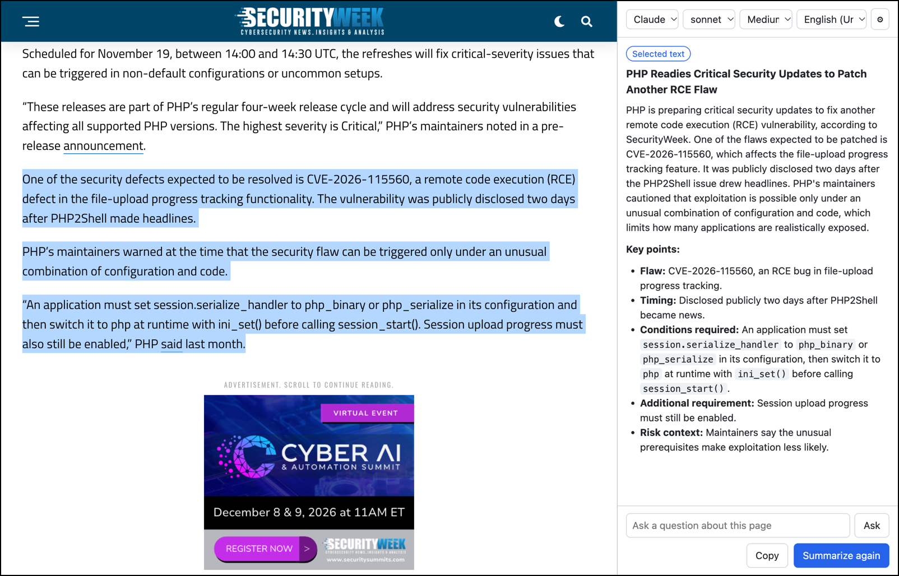

_Summarize the selection: select text, right-click, and only that part is summarized._

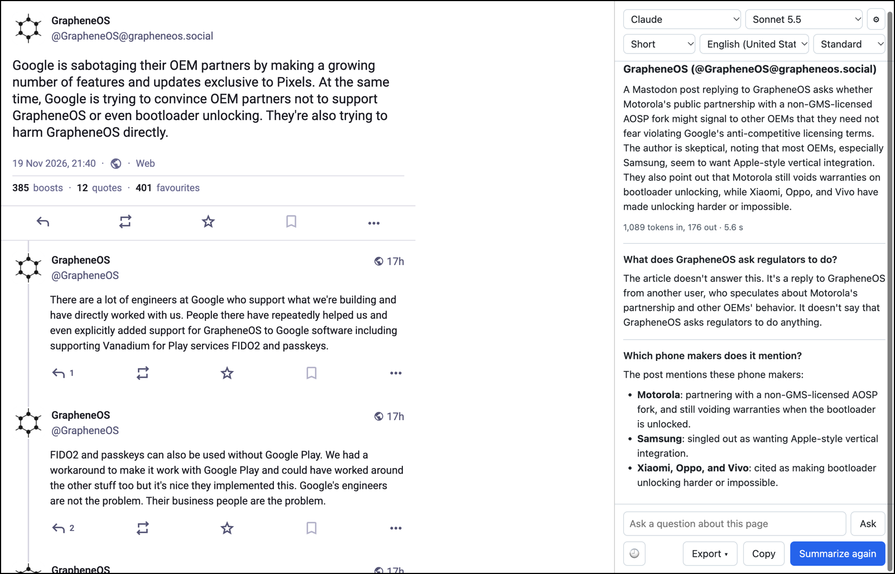

_Questions about the page: the answers appear under the summary and come from the page text only._

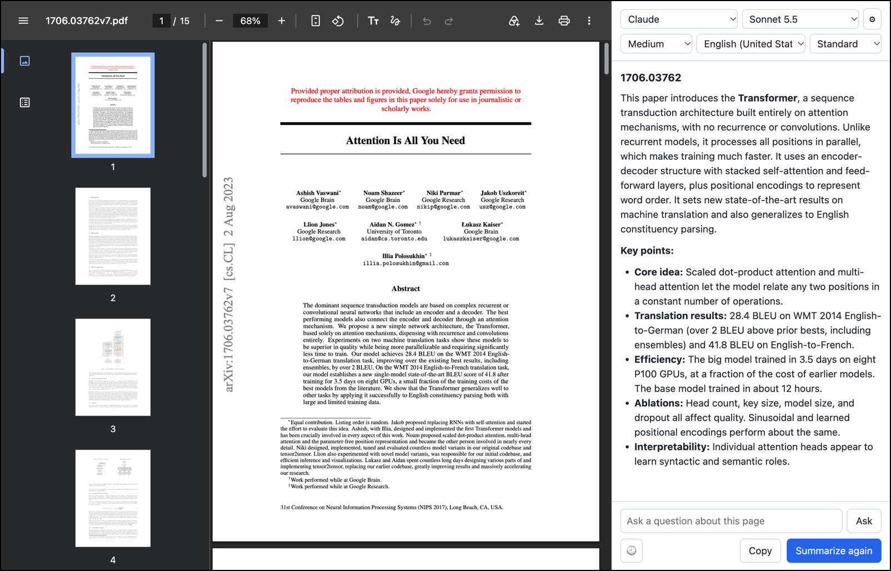

_PDFs: a paper from arXiv in Chrome's PDF viewer, summarized from its text._

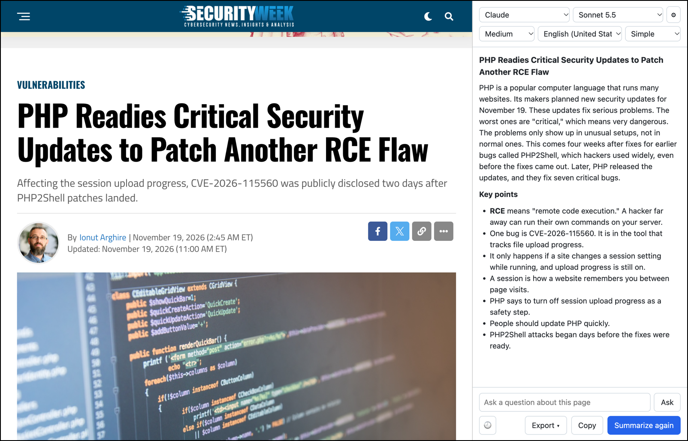

_Styles: the same article in the Simple style, which explains each technical term._

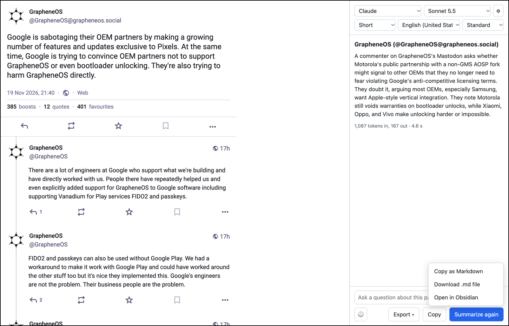

_Export: copy the summary as Markdown, save it as a .md file or open it in Obsidian._

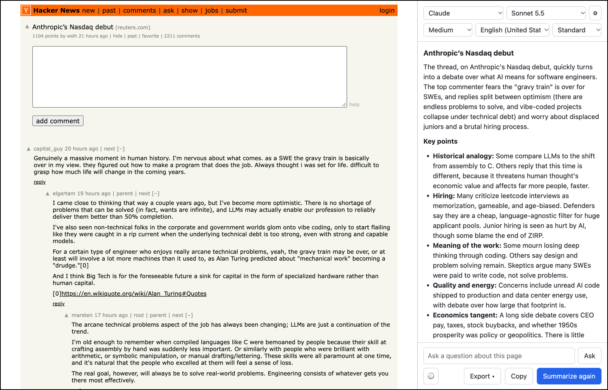

_Discussions: a Hacker News thread with over 2,000 comments, summarized as a debate._

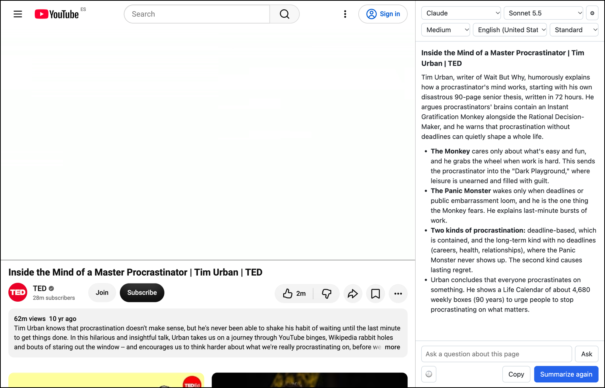

_YouTube: a video summarized from its transcript._

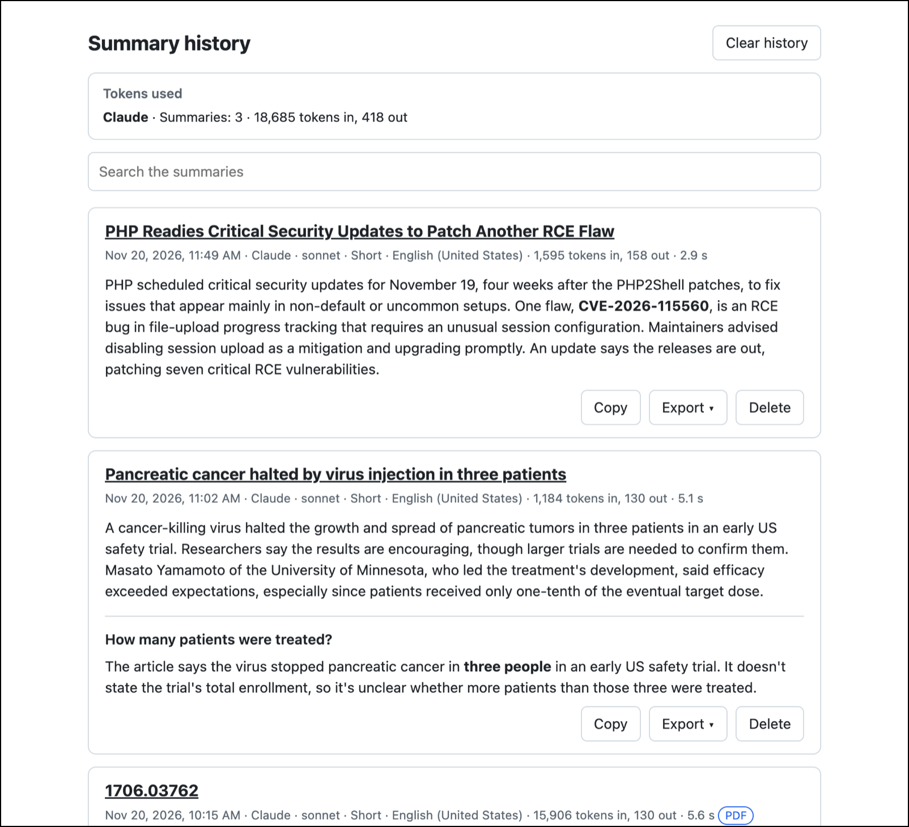

_The history: every summary, with its questions and the tokens it used, searchable and kept only on this computer._

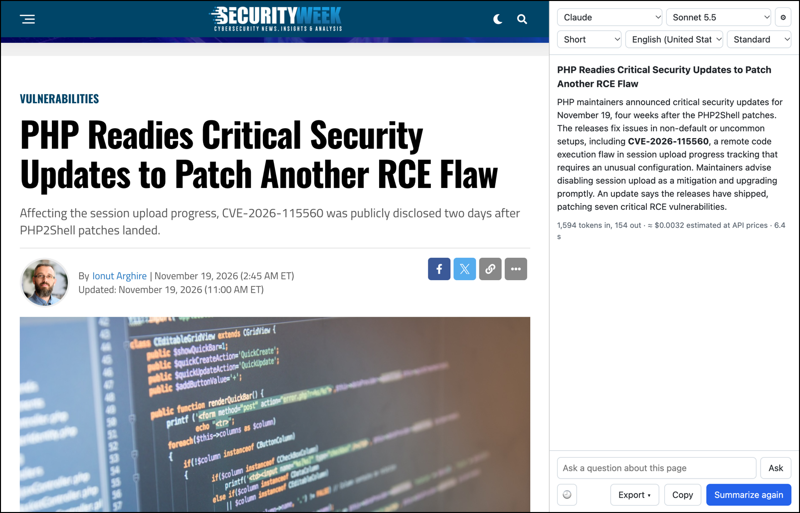

_SecurityWeek: short summary in English (United States), in the side panel._

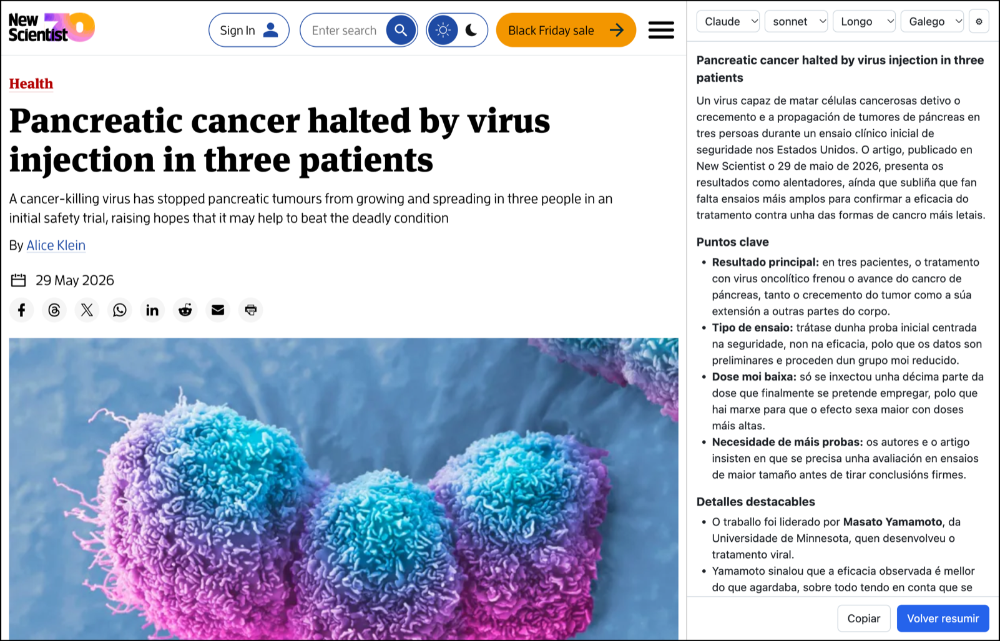

_New Scientist: long summary in Galician, in the side panel._

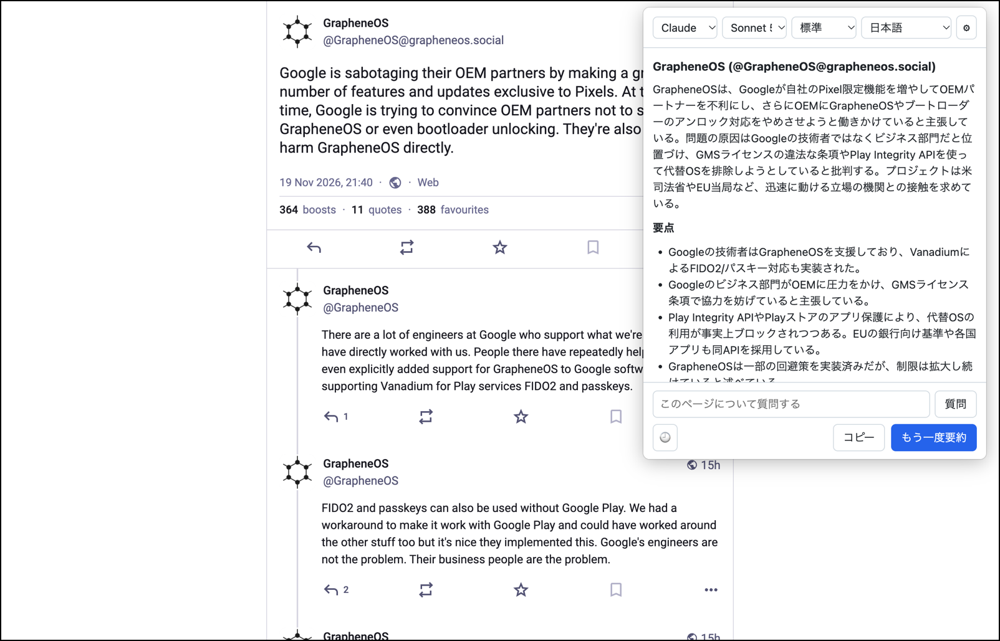

_A GrapheneOS thread on Mastodon: medium summary in Japanese, in the popup._

<details>
<summary>Six more: Spanish, French, German, Portuguese, Italian and Arabic</summary>

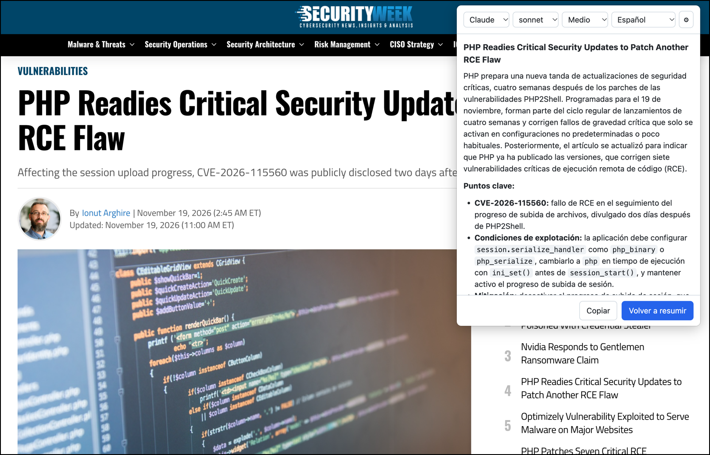

_SecurityWeek: medium summary in Spanish (Spain), in the popup._

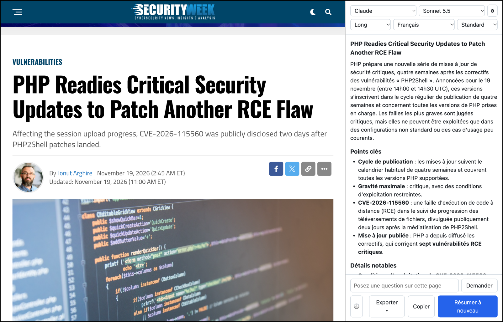

_SecurityWeek: long summary in French (France), in the side panel._


_New Scientist: short summary in German, in the popup._

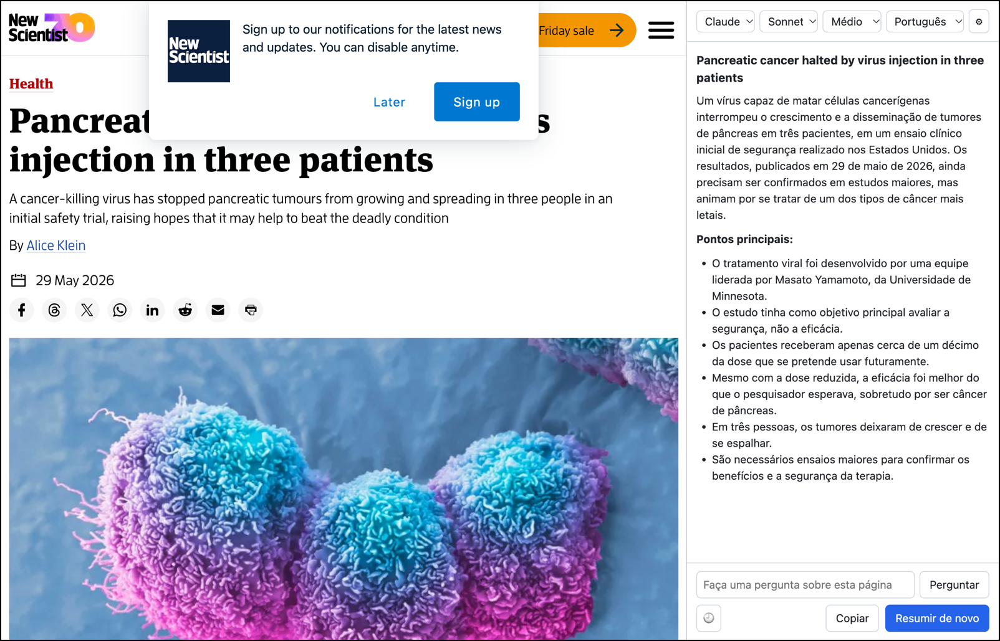

_New Scientist: medium summary in Portuguese (Brazil), in the side panel._

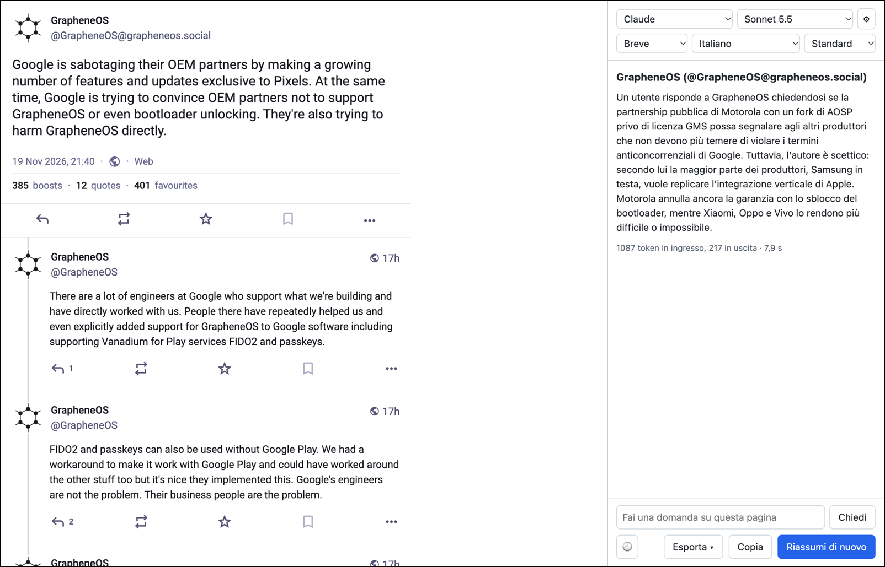

_A GrapheneOS thread on Mastodon: short summary in Italian, in the side panel._

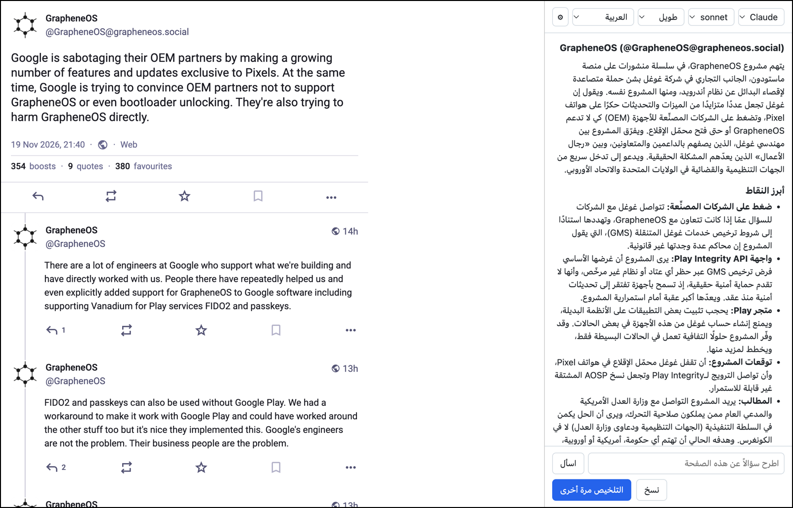

_A GrapheneOS thread on Mastodon: long summary in Arabic, right to left, in the side panel._

</details>

## Requirements

- macOS, Linux or Windows, with Google Chrome (or Chromium on Linux and Windows), or Firefox 140
  or later.
- Node.js 18 or later.
- At least one of:
  - [Claude Code](https://docs.claude.com/en/docs/claude-code), logged in with your Claude
    subscription (run `claude` once).
  - [Codex CLI](https://developers.openai.com/codex), logged in with your ChatGPT plan
    (`codex login`).
  - [Ollama](https://ollama.com), running, with at least one model downloaded (for example
    `ollama pull llama3.2`). Free and private: the page never leaves your computer. Small models
    write weaker summaries, especially in languages other than English.

## Install

There are two ways to get it, and neither needs a build; you only need Node.js for the local
component:

- **From a release** (no git): three zip files, described in
  [Install from a release](#install-from-a-release).
- **From the repository**: it includes the latest builds in [`dist/chrome`](dist/chrome) and
  [`dist/firefox`](dist/firefox). The numbered steps below are for Chrome this way; for Firefox, do
  step 1 and then see [Firefox](#firefox).

### Install from a release

Each [release](https://github.com/amieiro/browse-resume-ai/releases/latest) has three files. Their
names do not change between versions, so these links always get the latest one:

| File | What it is |
|---|---|
| [`browse-resume-ai-native-host.zip`](https://github.com/amieiro/browse-resume-ai/releases/latest/download/browse-resume-ai-native-host.zip) | The local component, needed by both browsers. |
| [`browse-resume-ai-chrome.zip`](https://github.com/amieiro/browse-resume-ai/releases/latest/download/browse-resume-ai-chrome.zip) | The extension for Chrome and Chromium. |
| [`browse-resume-ai-firefox.zip`](https://github.com/amieiro/browse-resume-ai/releases/latest/download/browse-resume-ai-firefox.zip) | The add-on for Firefox 140 or later. |

Keep everything in one folder that you will not move, for example `~/browse-resume-ai`: the local
component is registered with its full path.

**The local component** (always first). Unzip it in that folder and run its installer, which
registers it for Chrome, Chromium and Firefox:

```sh
mkdir -p ~/browse-resume-ai && cd ~/browse-resume-ai
curl -fsSLO https://github.com/amieiro/browse-resume-ai/releases/latest/download/browse-resume-ai-native-host.zip
unzip -oq browse-resume-ai-native-host.zip
./native-host/install.sh
```

On Windows, in PowerShell:

```powershell
$dir = "$HOME\browse-resume-ai"; New-Item -ItemType Directory -Force $dir | Out-Null; Set-Location $dir
Invoke-WebRequest https://github.com/amieiro/browse-resume-ai/releases/latest/download/browse-resume-ai-native-host.zip -OutFile browse-resume-ai-native-host.zip
Expand-Archive -Force browse-resume-ai-native-host.zip .
powershell -ExecutionPolicy Bypass -File native-host\install.ps1
```

**Chrome.** Unzip the Chrome file into a folder of its own, then load that folder as in steps 2 to
4 below (Developer mode, **Load unpacked**, check the ID):

```sh
cd ~/browse-resume-ai
curl -fsSLO https://github.com/amieiro/browse-resume-ai/releases/latest/download/browse-resume-ai-chrome.zip
unzip -oq browse-resume-ai-chrome.zip -d chrome   # then load the folder ~/browse-resume-ai/chrome
```

On Windows: `Invoke-WebRequest https://github.com/amieiro/browse-resume-ai/releases/latest/download/browse-resume-ai-chrome.zip -OutFile browse-resume-ai-chrome.zip`,
then `Expand-Archive -Force browse-resume-ai-chrome.zip chrome`.

**Firefox.** Download the Firefox file and load the zip itself, without unzipping it: open
`about:debugging#/runtime/this-firefox`, click **Load Temporary Add-on…** and choose
`browse-resume-ai-firefox.zip`. Read [Firefox](#firefox) for what a temporary add-on means.

```sh
cd ~/browse-resume-ai
curl -fsSLO https://github.com/amieiro/browse-resume-ai/releases/latest/download/browse-resume-ai-firefox.zip   # then load ~/browse-resume-ai/browse-resume-ai-firefox.zip
```

**To update**, run the same commands again in the same folder (they replace the files), run the
installer again, and reload the extension: the ↻ button in `chrome://extensions`, or **Reload** in
`about:debugging` for Firefox.

### Install from the repository

These steps use a clone of the repository, for Chrome. The screenshots in steps 2 to 4 apply to
the release folder too.

### 1. Get the code and install the local component

macOS and Linux:

```sh
git clone https://github.com/amieiro/browse-resume-ai.git
cd browse-resume-ai
./native-host/install.sh
```

Windows (PowerShell):

```powershell
git clone https://github.com/amieiro/browse-resume-ai.git
cd browse-resume-ai
powershell -ExecutionPolicy Bypass -File native-host\install.ps1
```

The installer prints the `node`, `claude` and `codex` it found. It needs at least one of `claude`
and `codex`, logged in. It registers the local component for Chrome, Chromium and Firefox.

### 2. Turn on Developer mode

Open `chrome://extensions` and turn on **Developer mode**, at the top right.

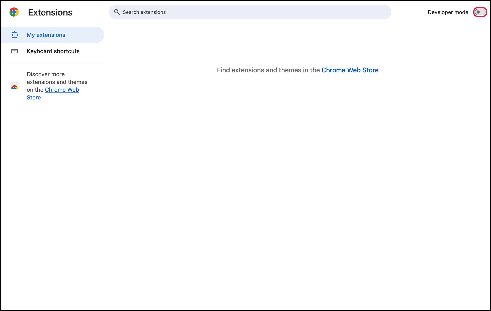

### 3. Load the extension

Click **Load unpacked**.

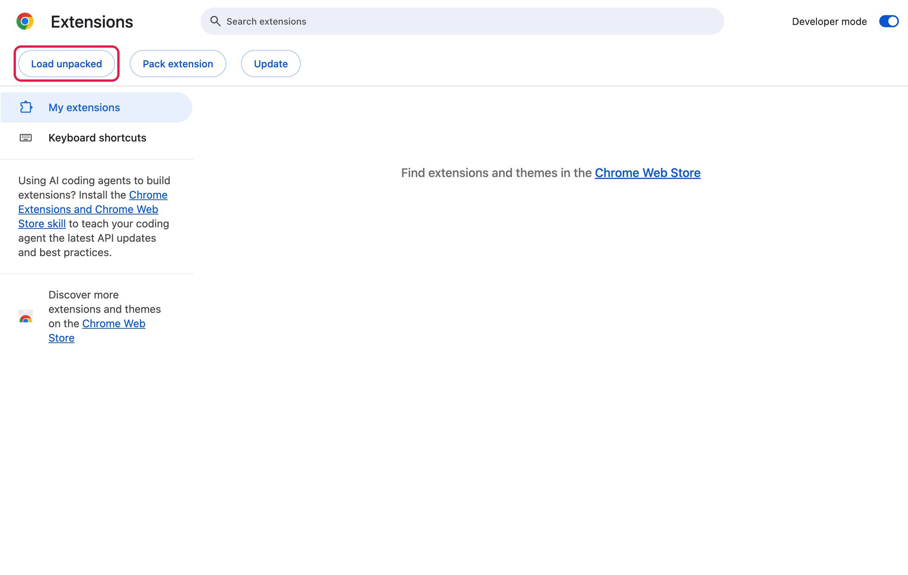

In the folder picker, choose the `dist/chrome` folder inside the repository and click **Select**.
On macOS you can press <kbd>Cmd</kbd>+<kbd>Shift</kbd>+<kbd>G</kbd> and paste the full path, for
example `~/browse-resume-ai/dist/chrome`; on Windows and Linux, paste the path in the picker's
address or location bar (<kbd>Ctrl</kbd>+<kbd>L</kbd> on Linux).

### 4. Check the extension ID

The card must show the ID `pdokiakaaeffjlabmofdppjakdhaimpi`. The local component only answers
this ID, so if it differs you loaded a different folder.


Chrome may list the extension under **Safety check** with "Chrome can't verify where this
extension comes from". That is normal for an extension loaded from a folder; keep it.

If the icon is not in the toolbar, open the puzzle-piece menu next to the address bar and pin
**Browse Resume AI**.

### 5. Check the settings

Click the gear in the panel, or **Details → Extension options** on the card. The providers you use
should say **Ready**. If one says the local component is not installed, run `./native-host/install.sh`
again (`install.ps1` on Windows). Here you also choose the interface language, where summaries are shown (side panel or
popup), and the defaults.


The model lists are read from what is installed on this computer: the models Claude Code offers
(one entry per model, such as **Sonnet 5.5**, which uses the alias `sonnet` and so follows the latest
Sonnet), the models in Codex's catalog, and the models downloaded in Ollama. Reading them costs no
request to the providers. They are read again once a day, when Claude Code or Codex changes version,
and when the extension is updated; **Read them now** does it at once. If a model is missing, add it
under **More models**. The local component reaches Ollama at `127.0.0.1:11434`, or at `OLLAMA_HOST`
if that is set where Chrome starts.

### 6. Summarize a page

Open an article and click the extension icon, or press <kbd>Alt</kbd>+<kbd>Shift</kbd>+<kbd>S</kbd>
(<kbd>Option</kbd>+<kbd>Shift</kbd>+<kbd>S</kbd> on a Mac). The summary appears in the side panel;
the selectors at the top change the provider, model, length and language for the next summary. To
use another shortcut, open `chrome://extensions/shortcuts`. If another extension already has
<kbd>Alt</kbd>+<kbd>Shift</kbd>+<kbd>S</kbd>, Chrome leaves this one without a shortcut; set one there.

The **Style** selector changes how the summary is written: **Standard**, **Simple** (simple words,
technical terms explained), **Figures and data**, **Formal** or **Critical** (with a note on weak
points and missing evidence). In the settings, under **Your styles**, you can add your own: a name
and an instruction, such as "Summarize it as a thread of three short posts". The default style is
chosen in the settings too.

Every summary goes to the **History** (the 🕘 button under the summary, or in the settings): a page
with all of them, newest first, a search that ignores case and accents, and buttons to copy or
delete each one or clear them all. It keeps the last 500 summaries in the extension's storage on
this computer and is never sent anywhere; turn it off in the settings with **Keep a history of
summaries**.

Under a finished summary, a grey line shows what it used: the tokens the model read (the prompt
with the page text) and wrote, and the seconds it took, as Claude Code, Codex or Ollama report
them. A summary shown again from the cache says **saved summary, no new use**: clicking the icon
again on the same page with the same settings does not spend your quota. The history shows the same
line on each summary and, at the top, the tokens used per provider. Answers to questions show the
same line under each answer and count in the totals too. With a subscription the tokens
are not billed one by one, but they count towards its usage limits.

The line also shows an **approximate cost**, "≈ $0.011 estimated at API prices": what the same
tokens would cost through the provider's paid API at list prices. It is an estimate, not what you
pay; a subscription is not charged per request. For Claude, Claude Code works it out itself. For
Codex, which reports no cost, it is calculated from OpenAI's API prices, which the local component
downloads once a day from [LiteLLM's public price list](https://github.com/BerriAI/litellm) (cached
input tokens at their lower price). Models without a known price show only the tokens. Ollama runs
on your computer and shows **local, no API cost**.

The **Export** button under a finished summary (and on each entry of the history) has three
options. **Copy as Markdown** copies the page title, a link to the page, the summary and the
answered questions. **Download .md file** saves the same text as a file named after the page, with
front matter (`title`, `source`, `created`) that note apps such as Obsidian read. **Open in
Obsidian** copies that note and opens Obsidian with an `obsidian://new` link, which creates it in
the vault you opened last; Chrome asks the first time whether to open Obsidian. The link takes the
note from the clipboard, so a long summary fits.

On Hacker News, Reddit, Lobsters and Discourse forums, a discussion is read as the post and its
comments, with their authors, points and reply depth, so the summary describes the debate (the
main points of view, agreements and disagreements) rather than the comments one by one. Only the
comments the page has loaded are read; the longest threads are cut at the summary limit, keeping
the comments the site shows first.

On a YouTube video, the summary is made from its transcript, as YouTube shows it under **Show
transcript** (the extension opens that panel if it is closed). Videos without subtitles or
automatic captions have no transcript to summarize.

A PDF open in Chrome is summarized the same way: the extension downloads the file and reads its
text. PDFs made of scanned images have no text to read. For PDFs on your computer (`file://`), turn
on **Allow access to file URLs** in the extension's **Details** in `chrome://extensions`.

To summarize only part of a page, select the text, right-click it and choose **Summarize the
selection**. The summary is marked **Selected text**, and **Summarize again** repeats it for the same
selection (with the length or language you pick). The right-click menu also has **Summarize the
page**.

Under a summary, the field **Ask a question about this page** answers questions about it, in the
summary language and from the page text only; follow-up questions keep the earlier ones in mind.
The questions and answers stay with the summary until the tab closes or a new summary starts.

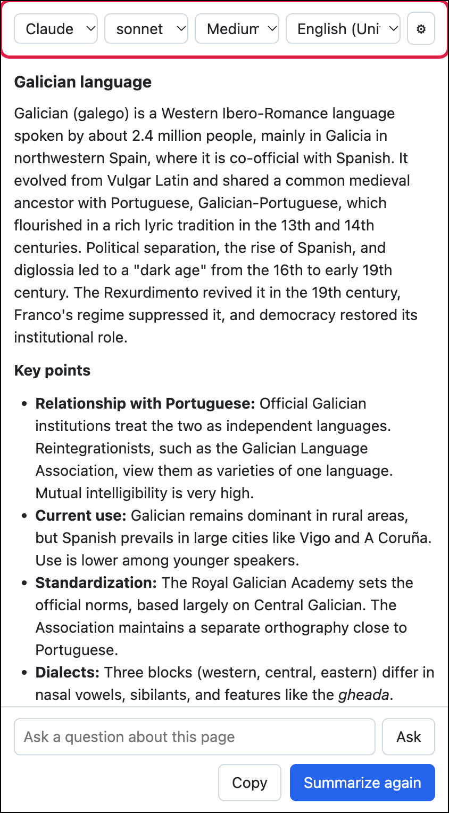

### Firefox

Firefox only installs add-ons signed by Mozilla for good, and this one is not signed yet. Until it
is, load it as a temporary add-on, which Firefox keeps until it restarts:

1. Run the installer of step 1 (it registers the local component for Firefox too).
2. Open `about:debugging#/runtime/this-firefox` and click **Load Temporary Add-on…**.
3. Choose `browse-resume-ai-firefox.zip` from the release, or the file `dist/firefox/manifest.json`
   in a clone of the repository.
4. Firefox asks to allow the add-on to send website content: that is the page text going to the
   local component and from there to the provider you pick.

Then click the toolbar icon (or press <kbd>Alt</kbd>+<kbd>Shift</kbd>+<kbd>S</kbd>): the summary
opens in Firefox's sidebar. Everything else works as in Chrome, with these differences:

- PDFs are read the same way, from the file, even though Firefox's PDF viewer cannot be read by
  extensions.
- Files on your computer (`file://`) cannot be summarized: Firefox has no setting like Chrome's
  **Allow access to file URLs**.
- Keyboard shortcuts are changed in `about:addons`, under the gear, **Manage Extension Shortcuts**.

Firefox Developer Edition, Nightly and ESR can keep it installed: set `xpinstall.signatures.required`
to `false` in `about:config`, then install `dist/firefox` zipped as an `.xpi` from `about:addons`.

### Update

```sh
cd browse-resume-ai
git pull
./native-host/install.sh   # Windows: powershell -ExecutionPolicy Bypass -File native-host\install.ps1
```

Running the installer again is only needed if `native-host/` changed, and it is harmless otherwise.

Then, in `chrome://extensions`, click the reload arrow on the extension card (marked in the
screenshot of step 4), or **Update** at the top of the page. Chrome does not pick up the new files
until you do.

### Why a local component?

Claude subscriptions can only be used through Claude Code, and Sign in with ChatGPT only accepts
redirects to `127.0.0.1`, which an extension cannot receive. So both providers go through a small
local program (a Chrome native messaging host) that runs `claude --print` or `codex exec` on your
computer, with your subscription.

The host gives the model no way to run commands or read files: Claude runs with no tools at all;
Codex runs with its shell and code execution disabled, inside a read-only sandbox. Each request
runs in an empty temporary directory that is deleted afterwards, and no session is saved.

```sh
./native-host/install.sh     # run again after moving the repository or upgrading Node, Claude Code or Codex
./native-host/uninstall.sh
```

On Windows, `native-host\install.ps1` and `native-host\uninstall.ps1` do the same.

Where the installer writes the launcher and the host manifest:

| System | Launcher | Host manifest |
|---|---|---|
| macOS | `~/Library/Application Support/browse-resume-ai/launcher.sh` | `~/Library/Application Support/Google/Chrome/NativeMessagingHosts/` |
| Linux | `~/.local/share/browse-resume-ai/launcher.sh` | `~/.config/google-chrome/NativeMessagingHosts/` and `~/.config/chromium/NativeMessagingHosts/` |
| Windows | `%LOCALAPPDATA%\browse-resume-ai\launcher.bat` | Next to the launcher, registered under `HKCU\Software\Google\Chrome\NativeMessagingHosts` and `HKCU\Software\Chromium\NativeMessagingHosts` |

The host only accepts connections from this extension's ID. On Windows, npm installs `claude` and
`codex` as `.cmd` files, which Node can only start through a shell; the installer stores the
JavaScript file they run instead, so the host never goes through `cmd.exe`.

## Extension ID

The manifest pins the extension ID with a public key, so every build loaded from source gets the
same ID:

```
pdokiakaaeffjlabmofdppjakdhaimpi
```

## Privacy

- The extension reads a page only when you click its icon (`activeTab`). It never reads pages in
  the background.
- The article text (at most 100,000 characters), its title and URL go to the local component and
  from there to the provider you selected (Anthropic or OpenAI, or Ollama on your computer), under your own account. Nothing is
  sent anywhere else.
- The last summary of each tab is kept for the browser session, so clicking the icon again on the
  same page does not spend your quota. It is cleared when the tab closes.
- Once a day, the local component downloads LiteLLM's public list of API prices from GitHub, for
  the estimated cost of Codex summaries. It is a plain download of a public file: nothing about you
  or your pages is sent.
- The history keeps your summaries (with their page titles, URLs and questions) in the extension's
  storage on this computer only. Turn it off or clear it at any time.

## Permissions

| Permission | Why |
|---|---|
| `activeTab` | Read the page you clicked the icon or the menu on. |
| `scripting` | Run the article extractor (Mozilla Readability) in that page. |
| `storage` | Save your settings, the history of summaries and the per-tab summary for the session. |
| `sidePanel` | Show summaries in the side panel (Chrome; Firefox uses its sidebar, which needs no permission). |
| `nativeMessaging` | Talk to the local component. |
| `offscreen` | Read PDFs with pdf.js in a hidden extension page, as a service worker cannot run pdf.js (Chrome; Firefox reads them in its background page). |
| `contextMenus` | Add **Summarize the selection** and **Summarize the page** to the right-click menu. |

## For AI agents

This section is for a coding agent (Claude Code, Codex or similar) asked to set the extension up on
a user's machine.

### What this is

A Manifest V3 extension for Chrome and Firefox (WXT + TypeScript) plus a local native messaging host
(`native-host/`, plain Node, no dependencies). The extension extracts the article from the active
tab and sends the prompt to the host; the host runs `claude --print` or `codex exec`, or calls the
Ollama HTTP API on the loopback, and streams the text back. The user's Claude or ChatGPT
subscription pays for the summaries, or Ollama runs them locally; there are no API keys to
configure.

### Install

1. Check the prerequisites. Stop and tell the user what is missing if any check fails.

   ```sh
   uname                  # Darwin or Linux; on Windows use the PowerShell installer
   node --version         # 18 or later
   command -v claude      # Claude Code, for the Claude provider
   command -v codex       # Codex CLI, for the Codex provider (at least one of the two)
   ```

   On Windows, check with `Get-Command node, claude, codex` in PowerShell.

   Do not log the user in yourself. If `claude` or `codex` is not logged in, ask the user to run
   `claude` (then `/login`) or `codex login`.

2. Download the latest release into a folder that will not move, and install the host. These
   URLs always point to the latest release; nothing needs building. Ask the user which browsers
   they use, and download only those zips (the host is always needed):

   ```sh
   mkdir -p ~/browse-resume-ai && cd ~/browse-resume-ai
   for f in native-host chrome firefox; do
     curl -fsSLO https://github.com/amieiro/browse-resume-ai/releases/latest/download/browse-resume-ai-$f.zip
   done
   unzip -oq browse-resume-ai-native-host.zip            # native-host/, package.json, LICENSE
   unzip -oq browse-resume-ai-chrome.zip -d chrome       # the Chrome extension folder
   ./native-host/install.sh   # prints the node, claude and codex paths it found
   ```

   On Windows (PowerShell):

   ```powershell
   $dir = "$HOME\browse-resume-ai"; New-Item -ItemType Directory -Force $dir | Out-Null; Set-Location $dir
   foreach ($f in 'native-host', 'chrome', 'firefox') {
     Invoke-WebRequest "https://github.com/amieiro/browse-resume-ai/releases/latest/download/browse-resume-ai-$f.zip" -OutFile "browse-resume-ai-$f.zip"
   }
   Expand-Archive -Force browse-resume-ai-native-host.zip .
   Expand-Archive -Force browse-resume-ai-chrome.zip chrome
   powershell -ExecutionPolicy Bypass -File native-host\install.ps1
   ```

   The Firefox zip stays zipped: Firefox loads it as it is. To work from a clone instead, run
   `git clone https://github.com/amieiro/browse-resume-ai.git`, then `./native-host/install.sh`
   in it; the builds are in `dist/chrome` and `dist/firefox`.

3. Check that the host answers. This must print a `pong` with `claudeFound` and/or `codexFound`
   set to `true`. Set `LAUNCHER` to the launcher path the installer printed:

   ```sh
   LAUNCHER="$HOME/Library/Application Support/browse-resume-ai/launcher.sh" node --input-type=module -e "
   import { spawn } from 'node:child_process';
   import { encodeMessage, createDecoder } from './native-host/lib/framing.mjs';
   const host = spawn(process.env.LAUNCHER, { shell: process.platform === 'win32' });
   host.stdout.on('data', createDecoder((m) => { console.log(JSON.stringify(m)); host.stdin.end(); }));
   host.stdin.write(encodeMessage({ type: 'ping' }));
   "
   ```

4. Hand over to the user for the last step. Loading an extension needs the browser's own pages and
   a native file picker, which an agent should not and usually cannot operate (and Developer mode
   is a browser setting the user must turn on). Give the user these instructions, with absolute
   paths:
   - Chrome: open `chrome://extensions`, turn on **Developer mode**, click **Load unpacked** and
     choose the `chrome` folder (for example `~/browse-resume-ai/chrome`, or `dist/chrome` in a
     clone). Check that the ID is `pdokiakaaeffjlabmofdppjakdhaimpi`, pin the extension and click
     its icon on an article.
   - Firefox: open `about:debugging#/runtime/this-firefox`, click **Load Temporary Add-on…** and
     choose `~/browse-resume-ai/browse-resume-ai-firefox.zip` (or `dist/firefox/manifest.json` in a
     clone). It stays until Firefox restarts; the add-on is not signed by Mozilla yet.
   - The **Install** section above has screenshots of each step; point the user to it.

5. To update later, repeat step 2 in the same folder and ask the user to reload the extension (↻
   in `chrome://extensions`, **Reload** in `about:debugging`).

### Rules

- Never pass the user's Claude subscription token to the extension or to any other tool. Claude is
  reached only through the user's own Claude Code.
- Do not change the flags in `native-host/lib/runner.mjs` or `native-host/lib/codex-runner.mjs`
  without re-running the prompt-injection check described in their comments: the page text is
  untrusted and the model must have no tool that runs commands or reads files.
- Run `./native-host/install.sh` again after moving the repository (or the release folder) or upgrading Node, Claude Code
  or Codex, because the launcher stores absolute paths.
- After changing the source, run `npm run dist` and commit `dist/chrome` and `dist/firefox` with the
  change, so the prebuilt extension in the repository stays current. If the change is visible in the screenshots,
  run `npm run screenshots` and `npm run gallery` (they open a separate Chrome with a temporary
  profile, and the gallery makes nine real summaries) and commit `media/install` and
  `media/gallery` too.
- Increase the version with every change, in `package.json` (`npm version patch|minor
  --no-git-tag-version`; patch for fixes, minor for features). The extension manifest and the
  native host take it from there, and the settings page shows it at the bottom.
- After adding, renaming or removing a heading in this README, run `npm run readme-toc` to update
  the table of contents at the top.

### Troubleshooting

| What the extension shows | Cause | Fix |
|---|---|---|
| The local component isn't installed or isn't answering | Host manifest missing, or the extension ID differs | Run `./native-host/install.sh`; check the ID in `chrome://extensions` |
| Claude Code wasn't found / Codex wasn't found | The CLI moved or was not installed when the installer ran | Install it and run `./native-host/install.sh` again |
| Claude Code isn't logged in | The Claude Code sign-in expired | The user runs `claude auth login` |
| Codex isn't logged in | Codex is signed out | The user runs `codex login` |
| No article text was found | The page is an app, a login wall or too short | Expected; try an article page |

## Development

```sh
npm install
npm run dev       # Chrome with the extension loaded and live reload
npm run build     # production builds in .output/chrome-mv3 and .output/firefox-mv3
npm run dist      # build and copy them to dist/chrome and dist/firefox, kept in the repository
npm run zip       # zips for Chrome and Firefox (and the sources zip Mozilla asks for) in .output
npm run release-assets  # the three files of a GitHub release, in .output/release
npm run screenshots  # regenerate media/install/*.png (needs the native host installed)
npm run gallery      # regenerate media/gallery/*.png: real summaries of real pages (same need)
npm run readme-toc   # regenerate the table of contents at the top of this README
npm test          # unit tests (extension and native host)
npm run compile   # type check
npm run test:linux            # Docker: unit tests, installer and Chromium end to end on Debian
npm run test:windows-scripts  # Docker: the Windows installer scripts, with PowerShell on Linux
npm run test:firefox          # Firefox end to end on this computer (needs Firefox and the native host)
```

Layout:

- `src/entrypoints/`: background service worker, side panel, popup, options page, and the
  extractor injected into pages.
- `src/lib/`: settings, prompt, extraction, Markdown rendering, cache and the per-tab summarizer.
- `src/providers/`: one module per provider behind a common interface.
- `src/lib/language-list.ts`: the language list; `src/locales/<code>.json`: interface strings, one
  file per language, with `en-US.json` as the source. The interface translations other than
  `en-US` and `gl-ES` were machine-translated and have not been reviewed by native speakers;
  corrections are welcome.
- `native-host/`: the native messaging host (plain Node, no dependencies) and its installers
  (`install.sh` for macOS and Linux, `install.ps1` for Windows).
- `test/linux/`, `test/windows/`: the Docker checks above; `test/firefox/`: the Firefox check.
- Chrome and Firefox share the code. Firefox has no side panel API (WXT makes the side panel page a
  sidebar), no offscreen documents (its background page reads PDFs) and its own add-on ID,
  `browse-resume-ai@amieiro.github.io`, which the local component's Firefox manifest allows.

## Licence

GPL-2.0-or-later. See [LICENSE](LICENSE).
