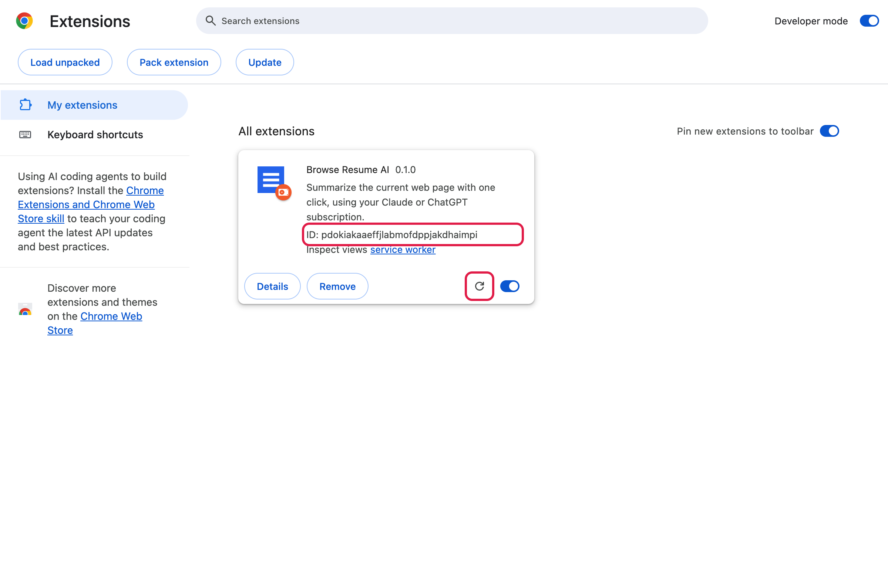
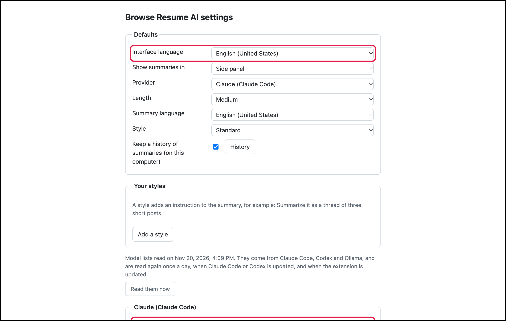

# Browse Resume AI

<!-- toc -->

**Contents**

- [Browse Resume AI](#browse-resume-ai)
  - [Requirements](#requirements)
  - [Install](#install)
    - [1. Get the code and install the local component](#1-get-the-code-and-install-the-local-component)
    - [2. Turn on Developer mode](#2-turn-on-developer-mode)
    - [3. Load the extension](#3-load-the-extension)
    - [4. Check the extension ID](#4-check-the-extension-id)
    - [5. Check the settings](#5-check-the-settings)
    - [6. Summarize a page](#6-summarize-a-page)
    - [Update](#update)
    - [Why a local component?](#why-a-local-component)
  - [Extension ID](#extension-id)
  - [Privacy](#privacy)
  - [Permissions](#permissions)
  - [For AI agents](#for-ai-agents)
    - [What this is](#what-this-is)
    - [Install](#install-1)
    - [Rules](#rules)
    - [Troubleshooting](#troubleshooting)
  - [Development](#development)
  - [Licence](#licence)

<!-- tocstop -->

A Chrome extension that summarizes the article in the current tab with one click, using the AI
subscription you already pay for: Claude (through Claude Code) or ChatGPT (through Codex). No API
keys, no pay-per-use billing.

- One click on the toolbar icon summarizes the page with your saved settings.
- Choose the provider and model, the length (short, medium, long) and the summary language.
- The summary appears in the side panel or in a popup; you pick which in the settings.
- 201 languages, for both the summary and the interface: the languages of
  [translate.wordpress.org](https://translate.wordpress.org/), with BCP 47 codes (ISO 639 language,
  ISO 3166 region, e.g. `gl-ES`, `pt-BR`) and ISO 639 names. The interface follows the browser
  language or the one you choose in the settings.

Status: personal project. Works on macOS, Linux and Windows with Google Chrome (and Chromium on
Linux and Windows). macOS and Linux are tested end to end; Windows is tested only through its
installer scripts, not on a Windows machine yet. A Firefox build is planned.

## Requirements

- macOS, Linux or Windows, with Google Chrome (or Chromium on Linux and Windows).
- Node.js 18 or later.
- At least one of:
  - [Claude Code](https://docs.claude.com/en/docs/claude-code), logged in with your Claude
    subscription (run `claude` once).
  - [Codex CLI](https://developers.openai.com/codex), logged in with your ChatGPT plan
    (`codex login`).

## Install

The repository includes the latest build in [`dist/chrome`](dist/chrome), ready to load in Chrome.
You do not need to build anything; you only need Node.js for the local component.

### 1. Get the code and install the local component

macOS and Linux:

```sh
git clone https://github.com/amieiro/browse-resume-ai.git
cd browse-resume-ai
./native-host/install.sh
```

Windows (PowerShell):

```powershell
git clone https://github.com/amieiro/browse-resume-ai.git
cd browse-resume-ai
powershell -ExecutionPolicy Bypass -File native-host\install.ps1
```

The installer prints the `node`, `claude` and `codex` it found. It needs at least one of `claude`
and `codex`, logged in.

### 2. Turn on Developer mode

Open `chrome://extensions` and turn on **Developer mode**, at the top right.


### 3. Load the extension

Click **Load unpacked**.


In the folder picker, choose the `dist/chrome` folder inside the repository and click **Select**.
On macOS you can press <kbd>Cmd</kbd>+<kbd>Shift</kbd>+<kbd>G</kbd> and paste the full path, for
example `~/browse-resume-ai/dist/chrome`; on Windows and Linux, paste the path in the picker's
address or location bar (<kbd>Ctrl</kbd>+<kbd>L</kbd> on Linux).

### 4. Check the extension ID

The card must show the ID `pdokiakaaeffjlabmofdppjakdhaimpi`. The local component only answers
this ID, so if it differs you loaded a different folder.



Chrome may list the extension under **Safety check** with "Chrome can't verify where this
extension comes from". That is normal for an extension loaded from a folder; keep it.

If the icon is not in the toolbar, open the puzzle-piece menu next to the address bar and pin
**Browse Resume AI**.

### 5. Check the settings

Click the gear in the panel, or **Details → Extension options** on the card. Both providers should
say **Ready**. If one says the local component is not installed, run `./native-host/install.sh`
again (`install.ps1` on Windows). Here you also choose the interface language, where summaries are shown (side panel or
popup), and the defaults.



### 6. Summarize a page

Open an article and click the extension icon. The summary appears in the side panel; the selectors
at the top change the provider, model, length and language for the next summary.


### Update

```sh
cd browse-resume-ai
git pull
./native-host/install.sh   # Windows: powershell -ExecutionPolicy Bypass -File native-host\install.ps1
```

Running the installer again is only needed if `native-host/` changed, and it is harmless otherwise.

Then, in `chrome://extensions`, click the reload arrow on the extension card (marked in the
screenshot of step 4), or **Update** at the top of the page. Chrome does not pick up the new files
until you do.

### Why a local component?

Claude subscriptions can only be used through Claude Code, and Sign in with ChatGPT only accepts
redirects to `127.0.0.1`, which an extension cannot receive. So both providers go through a small
local program (a Chrome native messaging host) that runs `claude --print` or `codex exec` on your
computer, with your subscription.

The host gives the model no way to run commands or read files: Claude runs with no tools at all;
Codex runs with its shell and code execution disabled, inside a read-only sandbox. Each request
runs in an empty temporary directory that is deleted afterwards, and no session is saved.

```sh
./native-host/install.sh     # run again after moving the repository or upgrading Node, Claude Code or Codex
./native-host/uninstall.sh
```

On Windows, `native-host\install.ps1` and `native-host\uninstall.ps1` do the same.

Where the installer writes the launcher and the host manifest:

| System | Launcher | Host manifest |
|---|---|---|
| macOS | `~/Library/Application Support/browse-resume-ai/launcher.sh` | `~/Library/Application Support/Google/Chrome/NativeMessagingHosts/` |
| Linux | `~/.local/share/browse-resume-ai/launcher.sh` | `~/.config/google-chrome/NativeMessagingHosts/` and `~/.config/chromium/NativeMessagingHosts/` |
| Windows | `%LOCALAPPDATA%\browse-resume-ai\launcher.bat` | Next to the launcher, registered under `HKCU\Software\Google\Chrome\NativeMessagingHosts` and `HKCU\Software\Chromium\NativeMessagingHosts` |

The host only accepts connections from this extension's ID. On Windows, npm installs `claude` and
`codex` as `.cmd` files, which Node can only start through a shell; the installer stores the
JavaScript file they run instead, so the host never goes through `cmd.exe`.

## Extension ID

The manifest pins the extension ID with a public key, so every build loaded from source gets the
same ID:

```
pdokiakaaeffjlabmofdppjakdhaimpi
```

## Privacy

- The extension reads a page only when you click its icon (`activeTab`). It never reads pages in
  the background.
- The article text (at most 100,000 characters), its title and URL go to the local component and
  from there to the provider you selected (Anthropic or OpenAI), under your own account. Nothing is
  sent anywhere else.
- The last summary of each tab is kept for the browser session, so clicking the icon again on the
  same page does not spend your quota. It is cleared when the tab closes.

## Permissions

| Permission | Why |
|---|---|
| `activeTab` | Read the page you clicked the icon on. |
| `scripting` | Run the article extractor (Mozilla Readability) in that page. |
| `storage` | Save your settings and the per-tab summary for the session. |
| `sidePanel` | Show summaries in the side panel. |
| `nativeMessaging` | Talk to the local component. |

## For AI agents

This section is for a coding agent (Claude Code, Codex or similar) asked to set the extension up on
a user's machine.

### What this is

A Chrome Manifest V3 extension (WXT + TypeScript) plus a local Chrome native messaging host
(`native-host/`, plain Node, no dependencies). The extension extracts the article from the active
tab and sends the prompt to the host; the host runs `claude --print` or `codex exec` and streams the
text back. The user's Claude or ChatGPT subscription pays for the summaries; there are no API keys
to configure.

### Install

1. Check the prerequisites. Stop and tell the user what is missing if any check fails.

   ```sh
   uname                  # Darwin or Linux; on Windows use the PowerShell installer
   node --version         # 18 or later
   command -v claude      # Claude Code, for the Claude provider
   command -v codex       # Codex CLI, for the Codex provider (at least one of the two)
   ```

   On Windows, check with `Get-Command node, claude, codex` in PowerShell.

   Do not log the user in yourself. If `claude` or `codex` is not logged in, ask the user to run
   `claude` (then `/login`) or `codex login`.

2. Get the code and install the host. The extension is already built in `dist/chrome`:

   ```sh
   git clone https://github.com/amieiro/browse-resume-ai.git
   cd browse-resume-ai
   ./native-host/install.sh   # prints the node, claude and codex paths it found
   ```

   On Windows: `powershell -ExecutionPolicy Bypass -File native-host\install.ps1`.

3. Check that the host answers. This must print a `pong` with `claudeFound` and/or `codexFound`
   set to `true`. Set `LAUNCHER` to the launcher path the installer printed:

   ```sh
   LAUNCHER="$HOME/Library/Application Support/browse-resume-ai/launcher.sh" node --input-type=module -e "
   import { spawn } from 'node:child_process';
   import { encodeMessage, createDecoder } from './native-host/lib/framing.mjs';
   const host = spawn(process.env.LAUNCHER, { shell: process.platform === 'win32' });
   host.stdout.on('data', createDecoder((m) => { console.log(JSON.stringify(m)); host.stdin.end(); }));
   host.stdin.write(encodeMessage({ type: 'ping' }));
   "
   ```

4. Hand over to the user for the last step. Loading an unpacked extension needs Chrome's Developer
   mode and a native folder picker, which an agent should not and usually cannot operate. Give the
   user these instructions:
   - Open `chrome://extensions` and turn on **Developer mode**.
   - Click **Load unpacked** and choose the `dist/chrome` folder (give the absolute path).
   - Check that the extension ID is `pdokiakaaeffjlabmofdppjakdhaimpi`, then pin the extension
     and click its icon on an article.
   - The **Install** section above has screenshots of each step; point the user to it.

### Rules

- Never pass the user's Claude subscription token to the extension or to any other tool. Claude is
  reached only through the user's own Claude Code.
- Do not change the flags in `native-host/lib/runner.mjs` or `native-host/lib/codex-runner.mjs`
  without re-running the prompt-injection check described in their comments: the page text is
  untrusted and the model must have no tool that runs commands or reads files.
- Run `./native-host/install.sh` again after moving the repository or upgrading Node, Claude Code
  or Codex, because the launcher stores absolute paths.
- After changing the source, run `npm run dist` and commit `dist/chrome` with the change, so the
  prebuilt extension in the repository stays current. If the change is visible in the screenshots,
  run `npm run screenshots` (it opens a separate Chrome with a temporary profile) and commit
  `media/install` too.
- After adding, renaming or removing a heading in this README, run `npm run readme-toc` to update
  the table of contents at the top.

### Troubleshooting

| What the extension shows | Cause | Fix |
|---|---|---|
| The local component isn't installed or isn't answering | Host manifest missing, or the extension ID differs | Run `./native-host/install.sh`; check the ID in `chrome://extensions` |
| Claude Code wasn't found / Codex wasn't found | The CLI moved or was not installed when the installer ran | Install it and run `./native-host/install.sh` again |
| Claude Code isn't logged in | The Claude Code sign-in expired | The user runs `claude auth login` |
| Codex isn't logged in | Codex is signed out | The user runs `codex login` |
| No article text was found | The page is an app, a login wall or too short | Expected; try an article page |

## Development

```sh
npm install
npm run dev       # Chrome with the extension loaded and live reload
npm run build     # production build in .output/chrome-mv3
npm run dist      # build and copy it to dist/chrome, the prebuilt folder kept in the repository
npm run screenshots  # regenerate media/install/*.png (needs the native host installed)
npm run readme-toc   # regenerate the table of contents at the top of this README
npm test          # unit tests (extension and native host)
npm run compile   # type check
npm run test:linux            # Docker: unit tests, installer and Chromium end to end on Debian
npm run test:windows-scripts  # Docker: the Windows installer scripts, with PowerShell on Linux
```

Layout:

- `src/entrypoints/`: background service worker, side panel, popup, options page, and the
  extractor injected into pages.
- `src/lib/`: settings, prompt, extraction, Markdown rendering, cache and the per-tab summarizer.
- `src/providers/`: one module per provider behind a common interface.
- `src/lib/language-list.ts`: the language list; `src/locales/<code>.json`: interface strings, one
  file per language, with `en-US.json` as the source. The interface translations other than
  `en-US` and `gl-ES` were machine-translated and have not been reviewed by native speakers;
  corrections are welcome.
- `native-host/`: the native messaging host (plain Node, no dependencies) and its installers
  (`install.sh` for macOS and Linux, `install.ps1` for Windows).
- `test/linux/`, `test/windows/`: the Docker checks above.

## Licence

GPL-2.0-or-later. See [LICENSE](LICENSE).
